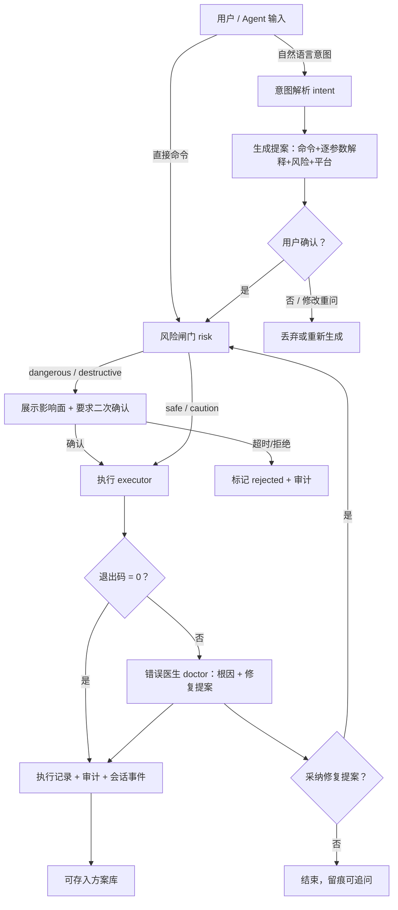

# 01 需求与业务原理（_01_business）

> 状态：draft　更新：2026-10-11

## 1. 需求背景

命令行是开发、运维与系统管理的核心界面，但对大多数人门槛过高。用户（项目所有者）将现有 Console 的问题归纳为十大痛点：

| # | 痛点 | 说明 |
|---|---|---|
| 1 | 记忆难题 | 命令太多且不断更新，记不住 |
| 2 | 选择难题 | 参数体系复杂，不知道该用哪些参数 |
| 3 | 编写难题 | 简单命令解决不了复杂问题，写 shell/bat 门槛高 |
| 4 | 分析难题 | 命令报错看不懂、不会分析 |
| 5 | 阅读难题 | 命令参数难以阅读理解（man/--help 生涩） |
| 6 | 恢复难题 | 命令执行没有回滚能力，出事难恢复 |
| 7 | 切换损耗 | 排查问题时频繁在 AI 工具与 Console 之间切换 |
| 8 | 保存难题 | 好用的命令/脚本没有地方沉淀 |
| 9 | Agent 难题 | 外部 Agent 工具对 console 的操作程度低（只能 shell out，拿不到结构化历史/审计/闸门） |
| 10 | 会话难题 | 会话不保存，断了就断 |

设计阶段的补充分析（P0）又识别出 8 个结构性缺陷：跨平台碎片化（同一意图三套命令）、危险操作无防护（rm -rf 一敲即中）、历史无上下文（丢了 cwd/结果/耗时）、长任务管理弱、输出不可结构化、环境漂移难诊断、包管理碎片化、安全与隐私（粘贴命令无来源标记、密钥进 history）。

**现有方案为什么不够**：atuin 只重做历史；Warp/Fig 走"替换终端"路线（Fig 已停运），封闭且改变用户习惯；各类 AI CLI 插件只做问答，无结构化提案、无风险闸门、无执行留痕、无方案沉淀，Agent 接入更是空白。iA-console 的差异化定位：**伴生智能内核**——不替换终端，以 daemon 形态补齐"意图 → 提案 → 执行 → 记录 → 沉淀"闭环，并把同一套能力经 MCP 原生开放给外部 Agent。

**为谁解决**：① CLI 初学者（记不住、看不懂）；② 跨平台开发者/运维（三套语法、危险操作）；③ 重度用户与 Agent 使用者（需要留痕、沉淀、自动化接口）。

## 2. 目标与非目标

| 类型 | 内容 |
|---|---|
| 目标 In | G1 意图输入：自然语言 → 结构化提案（命令+逐参数白话解释+风险等级），覆盖痛点 1/5、补充1（平台语法） |
| 目标 In | G2 参数向导：`explain` 返回命令参数规格表（名称/类型/默认值/白话解释），痛点 2/5 |
| 目标 In | G3 错误医生：执行失败自动诊断，产出根因假设（引用 stderr 证据）+ 修复提案，痛点 4 |
| 目标 In | G4 同屏 AI 对话：TUI 内对话，回答中的命令一键转提案执行，痛点 7 |
| 目标 In | G5 方案库：命令/脚本收藏、标签、检索、导出，痛点 8 |
| 目标 In | G6 会话持久化与恢复：会话事件流全量落盘，`resume` 接续上下文，痛点 10 |
| 目标 In | G7 全量执行记录与审计：含 Agent 发起的执行，补充3 |
| 目标 In | G8 风险闸门：四级风险、影响面展示、dangerous/destructive 需确认，补充2 |
| 目标 In | G9 Agent 原生接口：MCP Server（stdio）+ `--json` CLI 输出，痛点 9 |
| 目标 In | G10 可插拔 AI 后端：OpenAI 兼容协议多供应商档案，本地模型预留，痛点 7 支撑 |
| 目标 In | G11 习惯方言与命令翻译：用户设定习惯方言（linux/macos/windows），直接输入命令时自动翻译为主机等价命令并解释差异；**直接命令输入是零 AI 成本的一等路径，AI 仅在用户显式唤起时调用**（`iac ask` / TUI `??`）。静态映射表覆盖**官方常用命令全集**（POSIX/coreutils/bash 内建、PowerShell 高频 cmdlet、cmd 内置），含**参数级映射**；无法一对一映射的命令由 AI 规划**命令组合**并生成脚本，入库（方案库）并登记进映射，形成自增长闭环 |
| 目标 In | G12 内置本地模型：模型插件（推理引擎 + 模型权重）可从 HuggingFace/魔搭 ModelScope（含镜像）下载安装，无 API Key 也能开箱使用 AI 能力；同时支持直接配置本地模型路径与 OpenAI/Anthropic 规范远端 |
| 目标 In | G13 输入标记语言：一套符合直觉、不与现有命令冲突的标记——`??` 唤起 AI 解释/提问、`/` 进入 iA-console 内置管理命令（/config 等）、`---` 任务分隔（控制模型上下文）、`#` 会话备注、`\` 转义字面执行 |
| 目标 In | G14 阅读体验：iA-Writer 式排版美学（留白、弱框线、焦点模式）、白天/夜晚主题（可跟随终端）、字体渲染友好设计 |
| 目标 In | G15 执行回滚（v2）：基于效果日志的执行级回滚——不逐命令判断可逆性，前像统一入快照仓库，效果日志支持回滚到任意执行点与单文件版本恢复；删除效果先入回收站、retention 自动回收 |
| 非目标 Out | 不重写终端模拟器，不替换用户现有 shell |
| 非目标 Out | 不做 shell 集成 widget（Ctrl+Space 唤起等，v1.1 评估） |
| 非目标 Out | 不做任务编排/脚本生成（痛点 3）：v2 实现，v1 数据模型留位（提案支持多命令模板字段演进） |
| 非目标 Out | v1 不做执行回滚（痛点 6，G15，v0.2.0 以效果日志实现，机制见 _02 Q6-S4）：v1 留设计位（executions.journal_ref 字段与影响面预览钩子） |
| 非目标 Out | 不做远程多主机管理、IDE 插件、团队协作与云同步 |
| 非目标 Out | 不做模型训练/微调，不做完整模型管理 GUI（仅命令行级插件安装/列表/删除） |
| 非目标 Out | 不分发/替换终端字体（字体由终端模拟器决定；本项目提供字体选型建议与按等宽字体特性的排版设计） |
| 非目标 Out | v1 不做长任务守护与输出结构化适配层（补充4/5，登记为后续需求） |

## 3. 用户故事

```text
US-1 作为 CLI 初学者，我希望用一句中文描述目标就能拿到可直接执行的命令和逐参数解释，以便不必记忆和背诵任何命令。
US-2 作为 CLI 初学者，我希望查询任意命令的参数白话解释（默认值、必填性），以便读懂别人给的命令行。
US-3 作为受挫的用户，我希望命令失败时系统自动给出根因分析和修复命令，以便不必去搜索引擎和 AI 工具来回切换。
US-4 作为重度用户，我希望在 TUI 里与 AI 对话并把回答中的命令一键转成提案执行，以便思路不被切换打断。
US-5 作为重度用户，我希望把调通的好命令存进方案库（打标签、写说明），以便下次一秒复用。
US-6 作为多任务用户，我希望会话自动保存，关闭终端后能完整恢复上下文接着干，以便中断不丢工作状态。
US-7 作为 Agent 使用者，我希望外部 Agent 通过 MCP 查询历史、检索方案库、执行命令、保存方案，以便自动化流程与我的手动操作同一套闸门和审计。
US-8 作为谨慎的用户，我希望危险命令在执行前展示影响面并要求二次确认，以便不会一失手造成不可逆损失。
US-9 作为运维，我希望每一条命令执行（谁、何时、在哪、什么命令、结果如何）都有据可查，以便事后追溯与复盘。
US-10 作为用户，我希望一条命令管理 daemon 生命周期（start/stop/status），以便服务可控。
US-11 作为隐私敏感用户，我希望切换/配置多个 AI 后端（云、本地），以便平衡质量与隐私。
US-12 作为跨平台用户，我希望同一意图在不同平台得到的命令符合该平台 shell 语法，以便提案拿起来就能用。
US-13 作为在 Windows 上工作的 Linux 老手，我希望直接输入 ls 就拿到等价的 dir/Get-ChildItem 及差异说明，以便不切换命令思维（反向：Windows 用户在 Linux 上输 dir 同理）。
US-14 作为离线/隐私敏感用户，我希望一键从 HuggingFace 或魔搭下载安装内置模型插件，以便不配置任何 API Key 也能使用意图、诊断与翻译能力。
US-15 作为命令老手，我希望静态映射表覆盖官方常用命令全集且带参数级对应（改名的、值变换的、无等价的都告诉我），以便翻译结果可信、可解释。
US-16 作为用户，我希望 `??ls` 让 AI 解释 ls、`??` 加自然语言直接提问、`/config` 进入配置（终端类型、本地/远端模型地址）、`---` 开启新任务段不携带旧上下文，以便手不离键盘地掌控 AI 与配置。
US-17 作为长时间盯屏幕的用户，我希望界面像 iA-Writer 一样留白、克制、有日夜两套主题且能跟随终端切换，以便久看不疲劳。
US-18 作为手滑过的用户，我希望每次执行都有回滚日志：能回滚到任意执行点、能把单个文件恢复到某个版本（知道是哪条命令改的、恢复即替换）、删除的东西先进回收站自动清理，以便放心大胆地操作。
```

## 4. 业务流程



所有入口（TUI / CLI / MCP）经同一 dispatch 进入同一编排，闸门、记录、审计行为一致。

## 5. 领域概念表

| 概念 | 定义 | 与其他概念的关系 |
|---|---|---|
| iA-console | 本项目：伴生智能内核，代码命名 `ia_console` | 由 daemon 与前端组成 |
| 守护进程 daemon | 常驻后台进程 `iacd`，承载全部业务能力，提供 IPC/MCP 服务 | 前端与 Agent 都是它的客户端 |
| 前端 | `iac` 可执行程序：CLI 子命令 + TUI 两种形态 | 经 IPC 调用 daemon |
| 会话 Session | 一次连续工作上下文容器，可持久化恢复 | 包含有序会话事件；执行记录归属会话 |
| 会话事件 SessionEvent | 会话内按序追加记录：command/proposal/ai_message/note/diagnosis | 构成会话 |
| 意图 Intent | 用户以自然语言表达的目标 | 生成提案的输入 |
| 提案 Proposal | 为意图生成的结构化命令建议（命令/解释/风险/平台），状态 proposed→confirmed→executed 或 rejected | 确认后进入闸门执行 |
| 执行记录 ExecutionRecord | 一次命令执行的全量留痕 | 失败时触发诊断；可另存为方案 |
| 审计条目 AuditEntry | 追加式审计：发起方、动作、目标、明细 | 与执行记录互补，记录非执行类操作 |
| 方案 Recipe | 用户显式收藏的命令/脚本模板（标签/平台/风险） | 可由执行记录转存 |
| 命令知识 CommandKnowledge | 命令在某平台的结构化参数元数据，本地缓存 | 提案生成与参数向导的 grounding 数据 |
| 参数规格 ParamSpec | 命令知识中单个参数的结构描述 | 组成命令知识 |
| 风险等级 RiskLevel | safe/caution/dangerous/destructive 四级 | 风险评估的输出、闸门的依据 |
| 风险闸门 risk_gate | 执行前强制检查点，人机一致 | 依据风险评估决策 |
| 错误诊断 Diagnosis | 失败执行的结构化分析：根因+证据+置信度 | 产出修复提案 |
| 修复提案 FixProposal | 诊断给出的候选修复命令 | 采纳后走同一闸门 |
| 进程间通信 ipc | 前端↔daemon 通道：UDS/NamedPipe + JSONL 信封 | MCP 与 IPC 共享 dispatch |
| 模型上下文协议 mcp | 外部 Agent 的标准工具协议（stdio） | 工具集与 IPC 同构 |
| 模型后端 AiProvider | 一个可调用的 LLM 服务档案（OpenAI 兼容） | 可插拔切换 |
| 平台 Platform | linux/macos/windows（方案库另有 all） | 决定 shell 语法与提案目标 |

术语统一命名见 `_09_project_dict.json`。

## 6. 边界与异常场景

| 场景 | 触发条件 | 期望行为 |
|---|---|---|
| 空意图 | ask 输入为空或全空白 | 拒绝并提示，错误码 IAC-1103，不调用 LLM |
| 超长意图 | 意图 > 2000 字符 | 拒绝并提示拆分，IAC-1103 |
| AI 后端不可达/未配置 | 网络失败、Key 缺失 | 返回 IAC-1101 / IAC-5102 与配置指引；直接执行、历史、方案库不受影响 |
| LLM 返回非法结构 | 提案解析失败 | 自动重试 1 次；仍失败报 IAC-1102，保留原始响应供反馈 |
| 命令不存在 | spawn 返回 ENOENT | 记录失败执行，诊断给出"未安装/PATH 问题"假设，IAC-2101 |
| 输出超大 | stdout/stderr > 1MB | 记录截断摘要 + 原文落盘引用（stdout_ref/stderr_ref），不阻塞 |
| 多客户端并发 | TUI/CLI/MCP 同时读写 | SQLite WAL 模式，写经 daemon 串行化，不互锁 |
| daemon 未启动 | 前端连接失败 | 明确报 IAC-6101 并给出启动命令（不静默自动拉起） |
| 高危命令确认超时 | 30 秒未确认 | 自动取消，IAC-2104，审计记录 rejected |
| Agent 请求执行 destructive | 未携带确认标志 | 拒绝执行并返回影响面说明，要求 Agent 带确认重试（闸门与人一致） |
| 会话文件损坏 | load 校验失败 | 该会话标记 corrupted，列表其余会话不受影响 |
| 密钥安全 | 配置含 API Key | 默认从环境变量读取；日志与执行记录中密钥一律脱敏 |
| 方言翻译未命中且 AI 不可用 | 静态表查不到且后端不可达 | 返回原命令与说明（不阻塞直接执行），错误码 IAC-1301 |
| 插件下载中断/校验失败 | 网络中断或 sha256 不匹配 | 支持断点续传与重试；校验失败拒绝安装，IAC-1402 |
| 本地引擎启动失败 | 端口占用/引擎缺失 | 换端口重试一次；仍失败报 IAC-1403 并回退云后端 |
| 未知斜杠命令 | 输入 `/foo` 不在标记清单 | 报 IAC-1501 并列出全部可用标记，不当作 shell 命令执行 |
| 标记字面冲突 | 用户确实要运行 `??foo`、`/config`、`#xxx`、`---` 本体 | `\` 转义前缀按字面执行；CLI 子命令始终可用（iac ask/config 等） |
| 模型路径无效 | 本地 Provider 配置的模型文件不存在 | 报 IAC-5101 并指引检查路径，不阻塞其他 Provider |
| 非真彩终端 | 终端仅支持 256/16 色 | 主题降级到最接近色板，布局不破坏 |
| 回滚捕获范围外 | 命令写入范围外路径（如 /etc）或未经 iA 执行 | 效果日志标 out_of_scope 明示不可自动回滚（AC-29），闸门影响面在执行前已警示 |
| 回滚目标已回收 | retention 清理后请求回滚 | 明确报 IAC-1602 并提示最近可用回滚点 |
| 跨平台语法 | 同一意图在不同平台 | 提案命令符合当前平台 shell 语法，方案库按 platform 过滤 |

## 7. 验收标准（EARS）

```text
AC-01  WHEN 用户以自然语言提交意图 THE SYSTEM SHALL 在网络正常时 10 秒内返回结构化提案：完整命令、逐参数白话解释、风险等级、影响面说明。
AC-02  WHEN 用户执行 iac explain <命令> THE SYSTEM SHALL 返回参数规格表，优先本地知识缓存，未命中时经 help 解析与 AI 补全并回写缓存。
AC-03  WHEN 命令执行退出码非零 THE SYSTEM SHALL 自动生成诊断报告：根因假设（引用 stderr 原文为证据）+ 至少一条修复提案。
AC-04  WHEN 命令命中 destructive 规则（如 rm -rf 于系统路径、mkfs、dd 写块设备） THE SYSTEM SHALL 拒绝直接执行，展示影响面并要求显式二次确认。
AC-05  WHEN 任意命令执行完成（含 Agent 发起） THE SYSTEM SHALL 写入执行记录（命令、argv、cwd、shell、host、发起方、退出码、耗时、时间、会话）与审计条目。
AC-06  WHEN 用户执行 iac session resume <id> THE SYSTEM SHALL 恢复该会话事件流上下文，后续执行与 AI 对话延续该会话。
AC-07  WHEN daemon 重启 THE SYSTEM SHALL 保留全部会话、执行记录、方案库与审计数据，无丢失。
AC-08  WHEN 外部 Agent 经 MCP 调用 iac_execute THE SYSTEM SHALL 与人类执行同闸门同审计，返回结构化结果（退出码、输出摘要、记录 ID）。
AC-09  WHEN TUI 内 AI 回答包含命令块 THE SYSTEM SHALL 支持一键转为提案执行，无需复制粘贴。
AC-10  WHEN 用户保存方案 THE SYSTEM SHALL 入库标题、描述、命令模板、标签、平台、风险等级，并支持按关键词与标签检索。
AC-11  WHEN AI 后端不可达或未配置 THE SYSTEM SHALL 返回明确错误码（IAC-1101/IAC-5102）与配置指引，不影响直接执行与历史功能。
AC-12  WHEN 命令输出超过 1MB THE SYSTEM SHALL 记录截断摘要并落盘原文引用，不阻塞会话。
AC-13  WHEN 用户检索历史（万条级） THE SYSTEM SHALL 在 1 秒内返回匹配结果。
AC-14  WHEN 同一意图在 linux/macos/windows 提出 THE SYSTEM SHALL 产出符合当前平台 shell 语法的命令。
AC-15  WHEN dangerous/destructive 提案被确认后执行失败 THE SYSTEM SHALL 在诊断报告中明确提示当前版本无自动回滚能力。
AC-16  WHILE daemon 运行中 THE SYSTEM SHALL 以 WAL 模式支持多客户端并发读写不互锁。
AC-17  WHEN 用户执行 iac daemon start|stop|status THE SYSTEM SHALL 返回 daemon 生命周期操作结果与运行状态。
AC-18  WHEN 配置多个模型后端 THE SYSTEM SHALL 可指定默认后端并可按请求切换，切换不重启 daemon。
AC-19  WHEN 习惯方言≠主机方言且用户直接输入命令 THE SYSTEM SHALL 优先以静态映射生成主机等价命令提案（含差异说明），未命中时自动经 AI 翻译并把结果回写翻译缓存；全程不静默执行，须经确认。
AC-20  WHEN 用户直接输入命令且未显式唤起 AI THE SYSTEM SHALL 不产生任何模型调用（静态翻译命中时零 AI 成本）。
AC-21  WHEN 用户安装模型插件 THE SYSTEM SHALL 从配置源（HuggingFace/魔搭/镜像）下载引擎与模型、校验 sha256、注册为 local Provider 并可设为默认后端。
AC-22  WHEN 云后端不可用而本地引擎可用 THE SYSTEM SHALL 按配置自动降级到本地 Provider 并在结果中标注来源；两者皆不可用时返回明确错误码。
AC-23  WHEN 翻译静态映射命中 THE SYSTEM SHALL 返回等价命令、参数级映射表（直映/改名/值变换/无等价四类及说明）与风险等级，且不产生任何模型调用。
AC-24  WHEN 命令无法一对一映射 THE SYSTEM SHALL 调用 AI 规划命令组合并生成平台化脚本，经用户确认后存入方案库并登记进翻译映射（后续命中零 AI 成本）。
AC-25  WHEN 用户在 iA 输入框以 `??` 开头输入 THE SYSTEM SHALL 将其后内容作为 AI 解释或提问处理（`??ls` 解释命令、`??<自然语言>` 生成提案），不经 shell 执行。
AC-26  WHEN 用户输入 `/` 开头的内置管理命令（如 /config） THE SYSTEM SHALL 进入对应管理界面（TUI 面板 / CLI 交互向导），未知斜杠命令报 IAC-1501 并列出可用标记；`\` 前缀转义后按字面命令执行。
AC-27  WHEN 用户单独输入一行 `---` THE SYSTEM SHALL 结束当前任务段：其后 AI 调用不再携带该段之前的对话与执行上下文（历史记录仍完整保留）。
AC-28  WHEN 主题设置为 day/night/auto THE SYSTEM SHALL 应用对应配色（auto 跟随终端背景色），并在非真彩终端优雅降级到 256 色。
AC-29  (v2) WHEN 捕获范围内的命令执行完成且有文件变化 THE SYSTEM SHALL 生成文件级效果日志（op=created|modified|deleted|renamed，含前后像引用）并成为可选回滚点，全程无需按命令判断可逆性。
AC-30  (v2) WHEN 用户执行 iac rollback [执行点\|时间] THE SYSTEM SHALL 逆序回放效果日志至目标位置（point-in-time）；iac file history <路径> 可查看该文件全部版本（对应各次执行）并恢复到任一版本（直接替换）。
AC-31  (v2) WHEN 发生删除类回滚或快照回收 THE SYSTEM SHALL 删除效果先入回收站、按 retention（默认 7 天/1GB LRU）自动清理；回滚目标条目已被回收时明确报 IAC-1602 而非静默失败。
AC-32  (v2) WHEN 回滚日志执行点数超过上限 THE SYSTEM SHALL 按配置自动清退最旧执行点（rollback.max_entries 默认 1024，可配置，上限 65536），与天数/容量策略并行生效。
AC-33  (v2) WHEN 用户查看回滚列表 THE SYSTEM SHALL 以 history 风格展示每个执行点：行号(seq)、时间、当时命令、可回滚标识（可回滚/部分可回滚/不可回滚+原因）；并支持范围回放——回滚到指定行（其后全部逆序回放）、从指定行回滚到指定行（区间）、从指定行一直回滚到最远。
AC-34  (v2) WHEN 逐行倒序回放遇到不可回滚条目（冲突/引用缺失/权限） THE SYSTEM SHALL 提示用户逐条决策是否跳过；--on-conflict <ask|skip|abort> 参数可改变策略（skip 即默认跳过），决策结果计入回滚报告。
```

## 8. 未决问题

| 问题 | 影响 | 状态 |
|---|---|---|
| 回滚（痛点 6）v2 机制选型 | v2 架构；v1 已留 journal_ref 字段 | resolved（2026-10-11 评审定稿：效果日志方案，见 _02 Q6-S4；逆向命令知识废弃、git 方案废弃，回滚链路零 git 依赖） |
| 密钥存储：v1 环境变量，是否引入系统 keyring | config 设计 | open（v1 用环境变量+文档警示） |
| 是否内置常见命令知识离线包（ls/docker/git 等） | 冷启动体验 vs 包体积 | open（v1 先靠运行时解析+缓存） |
| 历史全文检索 FTS5 启用时机 | v1 用 LIKE+索引，v1.1 评估 FTS5 | open |
| 内置默认模型选型（小参数量 instruct 模型，GGUF 量化档位） | 插件默认项与体积/质量平衡 | open（候选 Qwen2.5-Coder-1.5B / Qwen3-1.7B 级别） |
| 静态映射表初始覆盖规模与维护方式（内置随版本发布 vs 运行时可更新数据包） | 翻译覆盖与发布节奏 | open（方向：内置官方常用全集 + AI 组合自增长） |
| shell 集成 widget（v1.1） | 前端形态扩展 | open |
