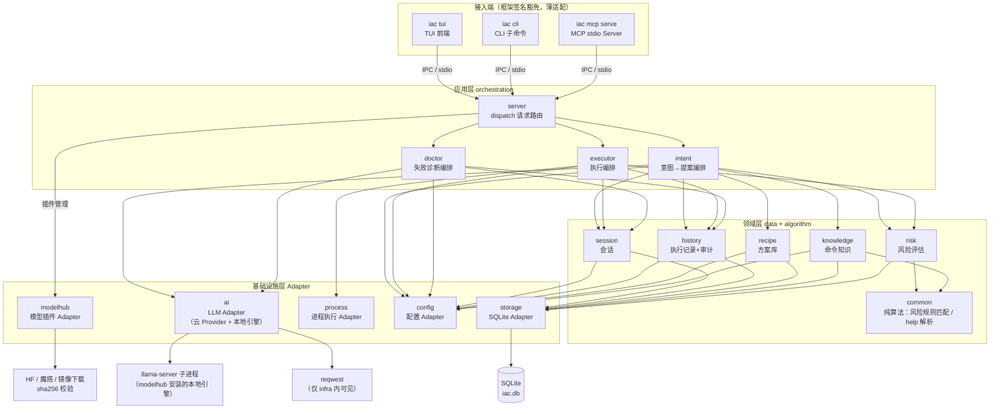

# 01 架构与模块职责（_04_framework_design）

> 状态：draft　更新：2026-10-11

## 1. 分层架构图

依赖方向必须自上而下单向：接入端 → app → domain →（ports trait）→ infra。infra 依赖 domain 定义在 `core/src/ports.rs` 的 trait（AiAdapter / ProcessAdapter / StorePort / ConfigPort），不反向感知上层。

## 2. 模块职责表

| 模块 | 层 | 职责 | 对应 _01 需求 | 对外暴露（见 _06） |
|---|---|---|---|---|
| server | app | IPC/MCP 请求信封解析、dispatch 路由到各编排、协议版本协商 | US-4/7/10 | IPC methods、MCP tools |
| intent | app | 意图→提案主流程（prompt 组装→AI 调用→解析→风险评估→落库）；参数向导 explain；**跨方言命令翻译编排（静态表优先、AI 兜底）** | US-1/2/11/12/13 | handle_ask、handle_explain、translate_command |
| executor | app | 提案执行主流程（闸门→执行→采集→记录→失败转诊断）；确认流 | US-3/8/9 | handle_execute、confirm_and_execute |
| doctor | app | 失败上下文构建→AI 诊断→结构化 Diagnosis + 修复提案 | US-3 | diagnose_failure |
| risk | domain | 风险规则装载、闸门决策（orchestration） | US-8 | assess_risk |
| session | domain | 会话与事件流的建立、追加、载入、列表、恢复 | US-6 | resume_session 等 5 方法 |
| history | domain | 执行记录写入/查询/详情、审计条目追加 | US-9 | record_execution 等 4 方法 |
| recipe | domain | 方案保存/检索/详情/删除 | US-5 | save_recipe 等 4 方法 |
| knowledge | domain | 命令知识查询/缓存写回；**跨方言翻译映射的查询与缓存** | US-1/2/13 | lookup_knowledge、cache_knowledge、lookup_translation、cache_translation |
| common | domain(算法集中地) | 纯算法：风险规则匹配、help 文本→参数 schema 解析 | US-8/2 | match_risk_rules、parse_help_text |
| ai | infra | LLM OpenAI 兼容调用、Provider 档案管理、**本地引擎子进程 supervisor** | US-11/14 | ai_complete、local_engine_ensure |
| storage | infra | SQLite 连接、查询/执行/迁移原语、ID 生成 | US-9 | storage_query/execute/migrate |
| process | infra | 跨平台进程执行：shell 选择、输出捕获、超时、kill | US-12 | spawn_process |
| config | infra | TOML 配置加载/保存、环境变量覆盖、路径定位 | US-10/11 | load_config、save_config |
| **modelhub** | infra | 模型插件下载/校验/安装/列表：HF/魔搭/镜像多源、sha256、断点续传 | US-14 | modelhub_install、modelhub_list |
| tui | 接入端（豁免） | TUI 事件循环与渲染组件；业务逻辑全部下沉 core | US-4/6 | —（UI 豁免） |
| cli | 接入端（豁免） | clap 子命令定义与参数适配到 IPC 请求；`--json` 出口 | US-1~10 | —（入口豁免） |

## 3. 依赖规则

- 禁止反向依赖与循环依赖：上层可用下层，下层不得感知上层；跨模块调用必须走 _06 定义的接口，禁止直接引用内部实现。
- **ports 先行**：core 在 `core/src/ports.rs` 定义 AiAdapter / ProcessAdapter / StorePort / ConfigPort trait；infra 实现之；core 单测以 mock 注入，不依赖真实外部组件。
- `algorithm` 方法集中在 `core/src/common/`，全局可复用。
- 外部组件封装红线：业务代码禁止直接 import 第三方组件（库/SDK/DB 驱动/HTTP 客户端），一律经 infra Adapter。**唯一记录在案的例外**：核心数据结构上的 serde derive 视为类型系统扩展（序列化标注），行为性组件（HTTP/DB/进程/TUI/MCP）无例外。
- 二进制拆分：`iacd`（daemon，含 server + 全部 core）、`iac`（前端，仅 IPC 客户端 + TUI/CLI）；core/infra 为 lib crate，两 bin 共享。

## 4. 公共机制

| 机制 | 方案 | 说明 |
|---|---|---|
| 配置 | infra::config：TOML（`~/.config/iac/config.toml`）+ 环境变量覆盖（`IAC_*`） | Provider 档案、默认后端、闸门策略、输出上限；API Key 默认仅从环境变量读 |
| 日志 | metrics 门面（框架层）→ tracing 后端实现 | 文件落 `~/.local/share/iac/logs/`，daemon debug 模式额外输出 stderr；业务方法禁止手写日志（method-spec 反模式） |
| 异常 | IAC-xxxx 错误码体系（见 _06 external 第 4 节）+ Evolution 回填 | infra Adapter 捕获第三方异常转译为错误码 + evolution.cause；禁止用异常做业务流程控制 |
| 追踪 | dispatch 注入 request_id，session_id 贯穿全链路；metrics 框架层自动计时 | 五段签名中 metrics/evolution 的落地点：框架在 dispatch 边界统一注入，逐层透传同一实例 |
| 事务 | SQLite WAL + daemon 内写操作串行化（单写者队列） | 追加式表（events/audit）与状态变更（proposals）同事务提交 |
| 观测 | metrics 门面统一收集：方法进出耗时、错误计数、AI 调用耗时/token 数 | 业务方法只写业务指标（如解析命中数），系统观测框架自动完成 |
