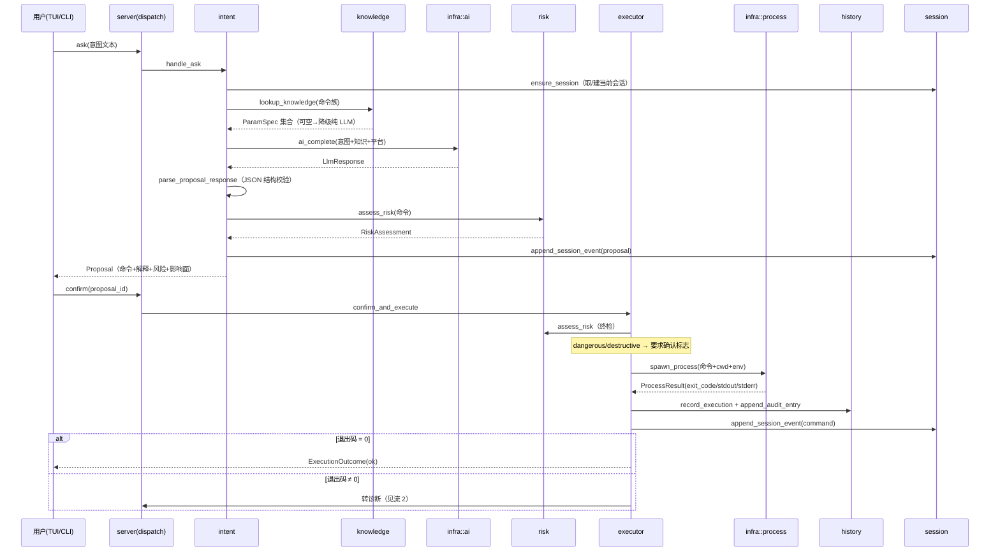
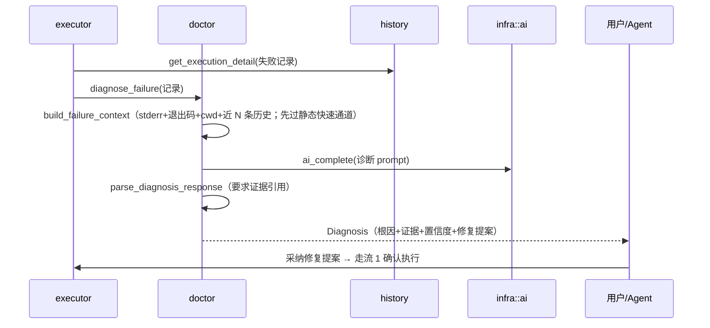
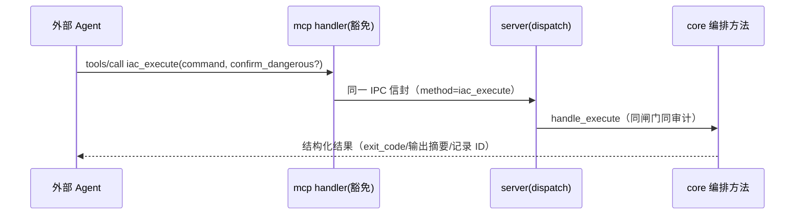
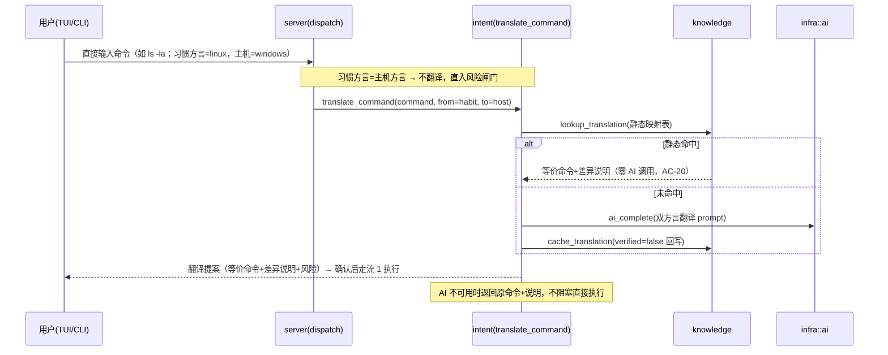

# 02 数据流与调用流（_04_framework_design）

> 状态：draft　更新：2026-10-11

## 1. 核心数据流

### 流 1：意图 → 提案 → 执行 → 记录（主闭环，AC-01/04/05）



### 流 2：失败 → 诊断（AC-03）



### 流 3：外部 Agent 经 MCP（AC-08）



### 流 4：跨方言直接输入翻译（AC-19/20，零 AI 成本优先）



## 2. 主调用链

以"用户意图到执行落库"为例（方法名以 _06 编号为准）：

```text
入口(iac cli/tui · 豁免) → dispatch_request(I-030, orchestration/app/server)
  → handle_ask(I-025, orchestration/app/intent)
      → ensure session: create_session / load_session(I-016/I-018, data/domain/session)
      → lookup_knowledge(I-003, data/domain/knowledge) → parse_help_text(I-002, algorithm/common)（未命中时）
      → ai_complete(IF-005, data/infra/ai)
      → parse_proposal_response(I-006, data/domain/intent)
      → assess_risk(I-023, orchestration/domain/risk) → match_risk_rules(I-001, algorithm/common)
      → append_session_event(I-017, data/domain/session)
  → confirm_and_execute(I-028, orchestration/app/executor)
      → spawn_process(IF-003, data/infra/process)
      → record_execution(I-008) + append_audit_entry(I-011)(data/domain/history)
      → [失败] diagnose_failure(I-029, orchestration/app/doctor)
            → build_failure_context(I-021, data/domain/doctor) → ai_complete(IF-005)
```

每个节点标注：方法名（_06 接口 ID）、category、层、模块；登记 _07 时映射为 m-xxx。

## 3. 数据模型概览

| 实体 | 关键字段 | 存储 | 归属模块 |
|---|---|---|---|
| Session | id/title/cwd/shell/host/status/时间 | SQLite sessions | session |
| SessionEvent | session_id/seq/kind/payload(JSON) | SQLite session_events | session |
| Proposal | id/intent/command/explanation/risk/platform/status | SQLite proposals | intent |
| ExecutionRecord | id/session_id/command/argv/cwd/actor/exit_code/输出摘要+落盘引用/risk/耗时/status/pre_snapshot_ref | SQLite executions | history |
| AuditEntry | ts/actor/action/target/detail(JSON) | SQLite audit_log | history |
| Recipe | id/title/description/command_template/tags/platform/risk/usage_count | SQLite recipes | recipe |
| CommandKnowledge | command/platform/schema(JSON)/source_hash/verified | SQLite knowledge_cache | knowledge |
| CommandTranslation | from_dialect/to_platform/command_from/command_to/notes/verified | SQLite translations | knowledge |
| ModelPlugin | id/name/engine/files(sha256)/size/status/installed_at | SQLite model_plugins | modelhub |

完整 DDL 见 _06 internal 第 3 节。关系：Session 1—N SessionEvent/ExecutionRecord/Proposal；ExecutionRecord 0—1 Proposal；Recipe 0—1 源 ExecutionRecord。

## 4. 容量与扩展假设

- 个人使用强度：执行记录 ~200 条/天 → 10 年约 73 万行；SQLite 单机轻松承载，索引检索毫秒级，满足 AC-13。
- 输出存储：单条 stdout/stderr 摘要上限 64KB，原文超 1MB 落盘文件（`~/.local/share/iac/outputs/`）记录引用，防库膨胀。
- 知识缓存：按 command+platform 唯一，量级千行内，无增长压力。
- 演进边界：单用户单机为设计边界；若未来多设备同步，引入行级 updated_at + 附加同步 journal 即可，不影响现 schema 主体；多主机管理属新需求走迭代流程。
