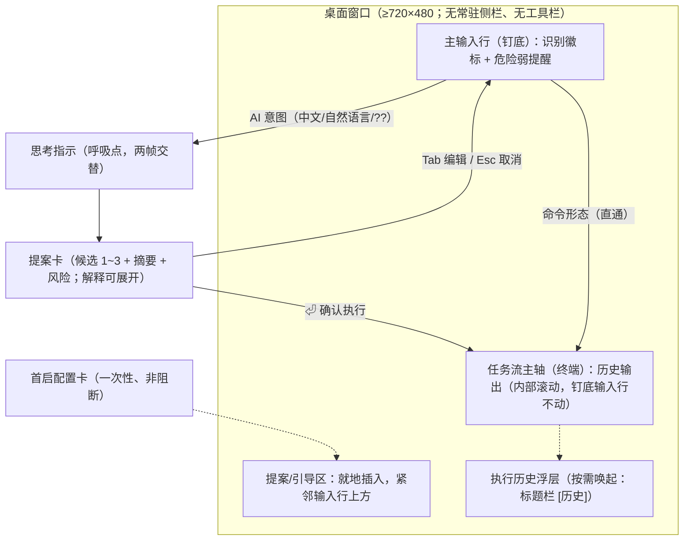

# 产品设计语言与界面原型规范：核心闭环（AI 驱动主输入行）

- **功能模块**：核心闭环（域 1 意图→提案 / 主输入行 / 提案卡 / 首启引导）
- **创建时间**：2026-10-17
- **介质形式**：双轨原型（Mermaid 空间拓扑 + ASCII 空间比例线框）+ 可交互 HTML 预览
- **关联 PRD**：`_02_feature_spec/_01_human_prd/01_overview_prd.md`
- **可交互 HTML 原型预览**：`_02_feature_spec/_03_prototype_html/core_loop_prototype.html`（双击打开，离线可用）
- **宏观品味宪章继承**：`_01_product_vision/_01_design_charter/DESIGN.md`（待建）——本版**候选继承**旧 iA-Writer 式设计语言（参考事实：旧 `_04_framework_design/03_ui_principles.md`，**待开发者确认**）
- **状态**：DRAFT（v0.1 · 交互走查版，未冻结）

> [!NOTE]
> 本版用途：把已确认决策（Q7/Q15/Q16/Q17 核心闭环 + Q8 首启）落成可视化原型，供开发者审阅「是否符合期望」。
> 标〔示意〕的细节**尚未确认**；14 令牌与风险分级配色为**候选继承**。可视化签收（Visual Sign-off）在阶段 0 冻结时进行（§10 占位）。

---

## 1. 视觉调性与设计哲学（候选继承）

- **设计隐喻与具体参照物**：iA Writer 编辑器的无框排版（内容即界面、语法弱化、Focus Mode）叠加终端网格；不是"参考风格"，而是逐词翻译到终端约束下。
- **受众与核心心智**：专业、精准、沉着、零干扰；内容（命令与解释文字）是主角，界面元素必须为自己辩护。
- **内容密度 (Density)**：`Balanced`——终端流高密（行高 1.72），提案卡区宽松（无框、留白分层）。
- **五条哲学**：① 内容即界面（辩不过就删除）② 减法至上（再删就坏为止）③ 层级只靠字重/灰阶/留白 ④ 一支笔（一屏最多一处 accent）⑤ 同一把尺子（间距来自节奏令牌，禁止随手值）。

---

## 2. Design Tokens（候选继承 · 14 令牌）

| 令牌 | day（纸） | night（墨） | 用途 |
|---|---|---|---|
| bg | `#FAFAF7` | `#1B1D22` | 纸面（day 暖白 / night 蓝黑，均非纯色） |
| fg | `#262A33` | `#D6D8DD` | 正文 |
| fg-60 | `#6B7080` | `#8B8F98` | 次要文字（摘要、参数说明） |
| fg-40 | `#9CA1AC` | `#5C6068` | 次次要（历史回显、提示） |
| fg-25 | `#C3C7CE` | `#3A3E46` | 装饰/标记/结构标点/注释 |
| accent | `#316BFF` | `#6E9BFF` | 唯一强调色：焦点行、活动卡色条、光标 |
| safe | `#2E7D32` | `#66BB6A` | 风险=安全 |
| caution | `#B26A00` | `#FFB74D` | 风险=留意 |
| dangerous | `#C7500A` | `#FF8A50` | 风险=高危 |
| destructive | `#B3261E` | `#FF5C52` | 风险=破坏性 / 错误 |
| diff-add | `#2E7D32` | `#66BB6A` | diff 增（本原型未用） |
| diff-del | `#B3261E` | `#FF5C52` | diff 删（本原型未用） |
| syn-keyword | `#8250DF` | `#C297FF` | 语法：关键字/键名（本原型未用） |
| syn-string | `#0A6E6E` | `#6FC7C7` | 语法：字符串（本原型未用） |

- **节奏尺**：旧 1 / 2 / 4 / 8 cell → GUI 约 4 / 8 / 16 / 32 px〔示意〕；段落 1 空行、卡片间 2 空行。
- **命令行语法分层**（输入行/提案/回显统一）：命令名 `fg`+bold → 长参数 `fg-60` → 值/路径 `fg-40` → 引号/管道 `fg-25`。
- **圆角与投影**：仅窗口有 10px 圆角 + 投影；**内部一切无卡片框、无色块底、无斑马纹**；分隔靠留白与 hairline（10% 透明度）。
- **动效**：无动画（状态变化=内容替换）；唯一动态为思考指示（两帧交替）。

---

## 3. 目标形态声明

- **目标端型**：桌面端（Linux / macOS / Windows）；**无响应式多端**（不适用 768/390 视口仿真）。
- **窗口**：最小尺寸 ≥ 720×480〔示意〕；终端字号随用户设置，布局不因字号破坏。
- **输入方式**：键盘优先（手不离键盘、视线不迁移）；鼠标可选（点击聚焦、点击选择候选）。
- **多标签**：本原型未含（终端多标签归域 18 走查）。

---

## 4. 轨一：空间划分与流转拓扑 (Mermaid)



---

## 5. 轨二：ASCII 空间比例线框（含 UI 标注）

> 各态仅示相关区域；完整交互见 HTML 原型。窗口内宽约 96 字符示意。

### 5.1 主界面 · 正常态 (Populated)

```text
+------------------------------------------------------------------------------------------------+
| ● ● ●                          iA-console — 核心闭环                                  [历史]  |
| [标题栏 H:36px, Border-b: 1px hairline(10%)；圆点 fg-25；标题 12px fg-40；按钮 12px fg-60]      |
+------------------------------------------------------------------------------------------------+
| ❯ cd ~/projects/demo                                                                           |
| ❯ ls                                                                                           |
| core/  docs/  src/  README.md  package.json                                                    |
| ❯ git status                                                                                   |
| On branch main                                                                                 |
| nothing to commit, working tree clean                                                          |
|                                                                                                |
| ❯ 找出当前目录下最大的 10 个文件                                        AI 意图                |
| ^ 输入行（钉底）：prompt fg-60 / 光标 accent；命令名 bold / 参数 fg-60 / 值 fg-40 / 管道 fg-25   |
+------------------------------------------------------------------------------------------------+
  [注] 终端流内部滚动；输入行钉底不动；无侧栏、无工具栏、无框线卡片；行高 1.72；内边距 14×18px。
```

### 5.2 提案态（单候选；上：摘要态 / 下：e 展开详解态）

```text
| ❯ 找出当前目录下最大的 10 个文件                                        AI 意图                |
|                                                                                                |
| ▍ du -ah . | sort -rh | head -n 10                                                             |
| ▍   按大小排序，列出当前目录下最大的 10 个文件 · 风险：安全                                     |
| ▍   [⏎ 执行] e 解释 · Tab 编辑 · Esc 取消                                                       |
+------------------------------------------------------------------------------------------------+
| ▍ du -ah . | sort -rh | head -n 10                                                             |
| ▍   按大小排序，列出当前目录下最大的 10 个文件 · 风险：安全                                     |
| ▍   du -ah .      统计当前目录下所有文件与目录的磁盘占用（-a 含文件、-h 人类可读）              |
| ▍   sort -rh      按人类可读数值降序排序（-r 逆序、-h 数值感知）                                |
| ▍   head -n 10    只取前 10 行                                                                  |
| ▍   影响：只读操作，不修改任何文件                                                              |
| ▍   [⏎ 执行] e 收起解释 · Tab 编辑 · Esc 取消                                                   |
+------------------------------------------------------------------------------------------------+
  [注] ▍=左侧 accent 色条（2px，无外框、无底色块）；[⏎ 执行] 为焦点键（反白）；风险值用语义色。
```

### 5.3 多候选态（↑↓ 切换；默认选中平台惯例最优）

```text
| ▍ tar -czf project.tar.gz .                                                                    |
| ▍   用 gzip 打包当前目录（Linux 惯例）· 风险：安全                                              |
| ▏ zip -r project.zip .                                                                         |
| ▏   生成 zip 压缩包（跨平台通用）· 风险：安全                                                   |
| ▏ 7z a project.7z .                                                                            |
| ▏   用 7z 高压缩比打包（需已安装 p7zip）· 风险：安全                                            |
|   ↑↓ 切换 · [⏎ 执行选中] · e 解释 · Tab 编辑 · Esc 取消                                         |
+------------------------------------------------------------------------------------------------+
  [注] 选中候选 ▍ accent 色条 + 命令 bold；未选中 ▏ fg-25 色条 + fg-60 文本；解释随选中项联动。
```

### 5.4 首启配置卡态 (FTUE)

```text
| ▍ 开始使用 AI 驱动                                                                             |
| ▍   [1 下载本地模型]  2 填写云 API Key  3 稍后再说                                              |
| ▍   免 Key 本地模型约 1.2 GB〔示意〕；未配置期间：直接命令、翻译、历史、方案库可正常使用。        |
+------------------------------------------------------------------------------------------------+
  [注] 一次性、非阻断：直进主界面后才出现，不遮挡终端与输入行；选择后即收起（下载/配置流程待走查）。
```

### 5.5 危险直输 · 弱提醒态（不拦截）

```text
+================================================================================================+
| ❯ rm -rf ./build/                                                                         ⚠    |
+================================================================================================+
  [注] 三件套：命令红字（destructive）+ 行尾 ⚠ + 视口边缘 1px 红描边（瞬时，执行后消退）；
       弱提醒不拦截，回车即执行（旧 AC-04 规则，待确认继承）。
```

### 5.6 异常错误态 (Error · AI 不可达〔示意〕)

```text
| ✘ AI 服务不可达（E-AI-503）· 请检查 AI 后端配置或稍后重试                                       |
| 直接命令、翻译、历史、方案库不受影响；输入已保留，可编辑后重试。                                 |
+------------------------------------------------------------------------------------------------+
  [注] 行内红字 + 错误码 + 一行指引；不弹窗、不遮罩；输入不丢失。
```

---

## 6. 页面四态对照

| 态 | 触发 | 原型落点 | 微文案 |
|---|---|---|---|
| Populated 正常 | 日常使用 | 历史流 + 输入行 + 识别徽标 | — |
| FTUE 空白引导 | 首次启动（AI 未配置） | 首启配置卡（§5.4） | 「开始使用 AI 驱动」+ 三选项 + 未配置期间说明 |
| Loading 加载 | AI 生成提案中 | 单行呼吸点（两帧交替） | `· · ·`（无帧率追求） |
| Error 异常 | AI 后端不可达 | 行内红字 + 错误码 + 指引（§5.6） | 「✘ AI 服务不可达（E-AI-503）…输入已保留」 |

---

## 7. 核心组件要点与键位

| 组件 | 要点 |
|---|---|
| 主输入行 | 混合识别徽标（`AI 意图` / `命令` / `字面执行`）〔示意〕；标记字符弱化（`??`、`\` 用 fg-25）；危险弱提醒三件套 |
| 提案卡 | ▍ 色条（活动 accent / 非活动 fg-25）；命令行层级着色；摘要 + 风险值语义色；解释默认收起（`e` 展开）；无外框无底色 |
| 思考指示 | 单行 fg-25 呼吸点，两帧交替；无动画帧率追求 |
| 错误行 | 行内红字 + 错误码（fg-40）+ 一行指引；不弹窗 |
| 历史浮层 | 无斑马纹；时间 fg-25、命令正文 fg、来源标注 fg-40；按需唤起 |
| 键位 | `⏎` 提交/确认 · `Esc` 取消 · `e` 展开/收起解释 · `Tab` 选中候选放入输入行编辑 · `↑↓` 切换候选 |

---

## 8. 与已确认决策映射 + Gherkin 草稿

| 已确认决策 | 原型落点 |
|---|---|
| Q7 主输入行直驱 | 输入行即 AI 驱动必经路径；无侧栏参与主流程 |
| Q15 混合识别 | 识别徽标 + 分流：中文/自然语言 → AI；命令形态 → 直执行；`??` 强制 AI；`\` 强制字面 |
| Q16 就地展开 | 提案卡紧邻输入行；解释默认收起（`e`）；`⏎` 确认 / `Esc` 取消 / 可编辑（`Tab`） |
| Q17 多候选 | 2~3 候选 `↑↓` 切换；默认选中平台惯例最优 |
| Q8 轻引导不挡路 | 首启配置卡（一键本地模型 / 云 Key / 稍后）；未配置期间基础能力完整可用 |

> Gherkin 草稿（冻结时钉为 DoD；REQ/DoD 编号待能力域闭合并分配）：

```gherkin
Scenario: 自然语言生成提案并确认执行
  Given 焦点在终端主输入行，AI 已配置
  When 输入「找出当前目录下最大的 10 个文件」并回车
  Then 输入行上方出现提案卡：候选命令 + 一句话摘要 + 风险标识
  And 命令不自动执行，等待确认
  When 按 ⏎
  Then 命令在终端执行并留痕（意图 + 命令 + 结果）

Scenario: 命令直通不产生 AI 调用
  Given 焦点在终端主输入行
  When 输入「ls -la」并回车
  Then 命令直接执行，不出现提案卡

Scenario: 多候选切换
  Given 提案卡含 2~3 个候选
  When 按 ↑/↓
  Then 选中项切换（accent 色条），解释随选中项联动
  When 按 ⏎
  Then 执行选中候选
```

---

## 9. 本次走查待确认清单（开发者反馈项）

| 编号 | 待确认项 | 建议默认 |
|---|---|---|
| V-01 | 提案卡位置：输入行上方（本版）还是下方？ | 上方（继承旧设计语言「反馈插入于输入行上方」） |
| V-02 | 识别徽标（AI 意图/命令/字面）是否够清晰、是否要更显眼？ | 维持 fg-40 弱标注 |
| V-03 | 键位集（`⏎`/`Esc`/`e`/`Tab`/`↑↓`）是否顺手？ | 维持 |
| V-04 | 风险 4 档（安全/留意/高危/破坏性）与配色是否继承？ | 继承旧 14 令牌 |
| V-05 | 危险直输「弱提醒不拦截」是否继承？ | 继承（旧 AC-04） |
| V-06 | 首启卡文案 / 选项 / 键位？ | 维持本版 |
| V-07 | 思考指示（呼吸点）形态？ | 维持两帧交替 |
| V-08 | 历史浮层形态（右滑出面板）？ | 维持按需唤起 |
| V-09 | 设计语言继承（iA-Writer 式 14 令牌 + 无框化）确认？ | 继承 |
| V-10 | 窗口最小尺寸 / 终端字号行为？ | ≥ 720×480〔示意〕 |

---

## 10. 开发者可视化确认签收单（占位 · 冻结时启用）

> 本次为**交互走查版**（v0.1）：先收集方向性反馈（§9）；正式 6 检查点签收在阶段 0 冻结时进行。

| 序号 | 检查项目 | 确认状态 | 备注 |
|---|---|:---:|---|
| 1 | 布局与容器结构（桌面窗口、钉底输入行、就地插入） | [ ] 待冻结 | |
| 2 | 字体与字阶层级（等宽终端 + 层级着色 + 灰阶三档） | [ ] 待冻结 | |
| 3 | 间距与设计令牌（节奏尺、单 accent 预算、无框化） | [ ] 待冻结 | |
| 4 | 桌面端交互特性（键盘键位、点击聚焦、窗口缩放） | [ ] 待冻结 | |
| 5 | 四态无死角（Populated / FTUE / Loading / Error） | [ ] 待冻结 | |
| 6 | 代码可映射性（CSS 变量 / 组件树无歧义） | [ ] 待冻结 | |

- **开发者签收结论**：`[ ] 核准通过 (APPROVED)` / `[ ] 需修改后重新提审 (REJECTED)`
- **签收工程师**：`hardstone`（待签）
- **签收日期**：`待定`
